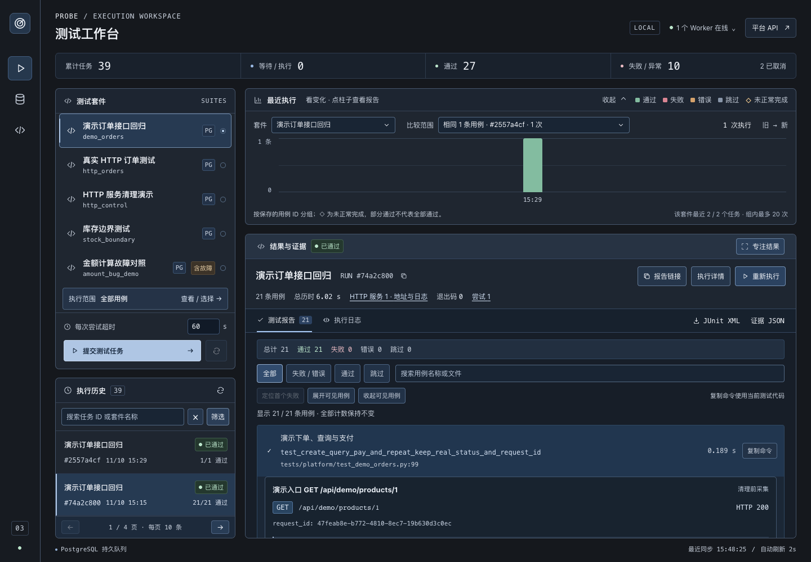
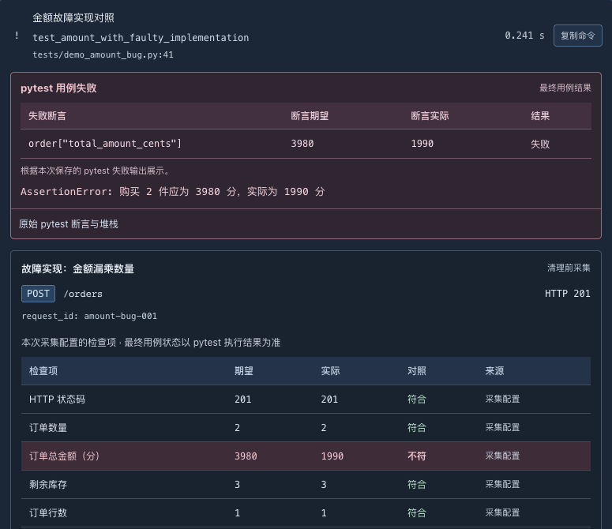
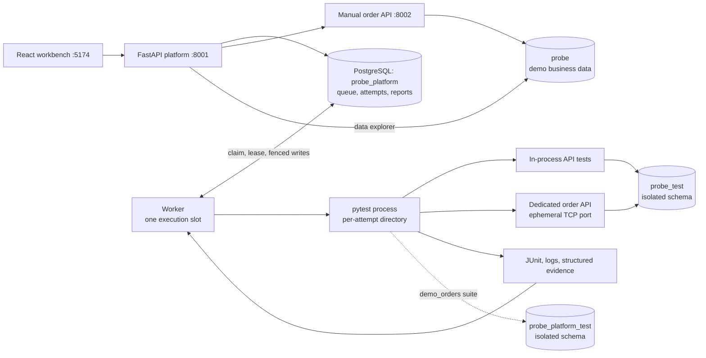

# Probe

[](https://github.com/Tsy-iii/Probe/actions/workflows/ci.yml)

**A local API test execution and failure-evidence workbench for SDET workflows.**

Select real pytest cases, execute them in isolated attempts, and inspect a failure through its assertion output, HTTP exchanges, database state, and service logs.

Built with **Python · FastAPI · pytest · httpx · PostgreSQL · SQLAlchemy · React · TypeScript · Vite**.

[简体中文](README.zh-CN.md) · [Start here](#read-without-running) · [Chinese guide index](docs/README.zh-CN.md) · [Architecture](docs/architecture.md) · [Verification](docs/verification.md)



*Local demonstration screenshot. Execution history and counts come from local runs; they are not production usage or performance metrics. The workbench UI and detailed operational guides are currently in Chinese.*

## What it does

- **Collect and select pytest cases:** browse parameterized cases and source locations, execute a whole suite or a subset, and save the submitted case selection.
- **Persist test jobs:** queue work in PostgreSQL, deduplicate submissions using an idempotency key, and retain runs and execution attempts.
- **Control execution:** cancel queued or running jobs, enforce per-attempt timeouts, and recover expired Worker leases with bounded retries.
- **Exercise real HTTP:** run tests against a dedicated order-service process on an OS-assigned TCP port, separate from the manual demo API.
- **Preserve failure evidence:** store request/response data, selected headers, explicit checks, database snapshots, assertion output, and logs before test-data cleanup.
- **Find and reproduce results:** search and filter history, create linked reruns, reopen report links, and export JUnit XML, logs, and evidence JSON.
- **Inspect the demo business:** browse products, orders, and payment events; manage demo products and call create/pay/cancel endpoints from the UI.

## Read without running

The included order API is the test target. Probe executes trusted pytest code from this repository; the workbench selects cases, controls jobs, and displays saved results. It does not generate assertions from UI selections.

There is no hosted demo. Start with the screenshots above and below, then follow these concrete implementation and evidence paths without installing the project:

| Question | What to inspect | Entry |
| --- | --- | --- |
| How does an order avoid overselling or partial writes? | Conditional stock UPDATE and order INSERT in one transaction; concurrent and rollback assertions | [Order implementation](probe/service.py) · [Order tests](tests/test_orders.py) |
| Can HTTP 201 still hide a business error? | Expected 3980 cents versus actual 1990, with saved HTTP and database observations | [Controlled amount investigation](docs/postmortems/incorrect-amount.md) |
| Can an old Worker overwrite a recovered run? | Worker/attempt/state/lease checks, interrupted history, and cleanup verification | [Recovery investigation](docs/postmortems/worker-loss.md) · [Reliability tests](tests/platform/test_reliability.py) |

[Project FAQ (中文)](docs/project-faq.zh-CN.md) explains assertions, test isolation, demo editing, and run/attempt semantics. [Verification](docs/verification.md) and [CI records](docs/ci.md) state the dates, code versions, and limits behind recorded results. To execute a new run, follow [Quick start](#quick-start).

## Try a run

After [starting the project](#quick-start):

1. Open the workbench at **http://127.0.0.1:5174**.
2. Select **Real HTTP order tests** (`http_orders`, shown as `真实 HTTP 订单测试`) and open the case picker.
3. Choose all cases or a subset, then submit a job.
4. Open the resulting report and inspect the request, response, checks, and database snapshots.
5. Run **Amount calculation contrast** (`amount_bug_demo`) to inspect a controlled failure. Its deliberately incorrect implementation should remain failed in the report.
6. Use **Rerun** to create a new execution linked to the previous run. Submission replay returns the existing run instead.

The included order API is a small test target: a single-product order reserves stock, payment changes its state, and cancellation restores stock once. It provides concrete transaction, concurrency, and idempotency scenarios for the runner.

### Failure evidence



*Saved evidence from a real local controlled-failure run: the request returned HTTP 201, but the expected total was 3980 cents and the actual total was 1990 cents. The corresponding database snapshots retain stock changing from 5 to 3 and the incorrect order amount. This illustrates why an HTTP success response alone does not establish business correctness.*

## Architecture



The API accepts and queries jobs. A separate Worker reads the durable queue and executes pytest. Test databases are distinct from both demo business data and the actual platform history.

### Execution and reliability model

| Mechanism | Implementation and scope |
| --- | --- |
| PostgreSQL queue | `FOR UPDATE SKIP LOCKED` claims a queued run and creates its attempt in one transaction. PostgreSQL is already required for the project, so there is no Redis dependency. |
| Submission idempotency | A unique key and a normalized request fingerprint coordinate repeated submissions. Conflicting parameters return 409. This deduplicates job creation, not arbitrary external side effects. |
| Worker lease | Heartbeats renew ownership only while the existing lease is valid. Defaults are a 1-second heartbeat and a 6-second lease. |
| Attempt fencing | Completion checks the Worker, active attempt, state, and unexpired lease before committing a result. A stale attempt cannot overwrite its replacement. |
| Recovery | A replacement Worker takes recovery ownership, stops and cleans the old attempt, then may requeue it. Worker loss has bounded retries; assertion failures, timeouts, and cancellations are not retried into a pass. |
| Execution isolation | Each attempt has a process/session, working directory, pytest temporary directory, artifacts, and an isolated PostgreSQL schema when required. This is isolation for trusted tests, not a security sandbox. |
| Evidence chain | Tests record evidence before assertions and fixture cleanup. JUnit properties are parsed into persisted JSONB reports. TCP tests additionally retain service addresses and service logs. |

`cleanup_done` covers active test processes and test schemas. Logs, reports, and working directories remain available for diagnosis; automatic artifact retention is not implemented.

See [architecture and engineering tradeoffs](docs/architecture.md) for the code map and the tests behind these mechanisms.

## Quick start

Run commands from the repository root after cloning or downloading the project.

### Requirements

- Python **3.14** for the recorded dependency environment.
- Node.js **22.12+** or **20.19+**, with npm.
- PostgreSQL **17**. Use an existing local instance, Docker Compose, or the optional project-local server below.
- A POSIX environment for Worker process control. Verification covers local macOS arm64 and Ubuntu 24.04 CI; it does not establish support for every POSIX system.

### 1. Install dependencies and configure the environment

```bash
python3 -m venv .venv
.venv/bin/python -m pip install -r requirements.lock.txt

# Preserve an existing local configuration.
if [ ! -f .env ]; then cp .env.example .env; fi

cd frontend
npm ci
cd ..
```

`.env.example` contains development defaults, not production credentials. Review the four database URLs when using a different PostgreSQL instance or port. Keep the databases separate:

| Database | Purpose |
| --- | --- |
| `probe` | Persistent manual-demo products, orders, and payment events |
| `probe_test` | Temporary order-test schemas |
| `probe_platform` | Actual job history, attempts, and reports |
| `probe_platform_test` | Temporary platform-test schemas, including the `demo_orders` suite |

### 2. Prepare PostgreSQL

**Docker Compose option:**

```bash
docker compose up -d postgres
```

The initialization script creates the additional databases on a fresh volume. Existing volumes are preserved; see [setup and troubleshooting](docs/README.zh-CN.md) if the databases already exist or initialization is incomplete. The Compose configuration is provided, but its startup path has not yet been verified in the recorded local environment.

**Verified local alternative when Docker is unavailable:**

```bash
.venv/bin/python -m pip install -r requirements-local-db.txt
.venv/bin/python -m probe.local_postgres start
```

This starts a real PostgreSQL server, creates the four databases if missing, and preserves its data under `.local/postgres/`. This optional path was verified on macOS arm64.

Initialize schemas and demo products:

```bash
.venv/bin/python -m probe.manage init-db
.venv/bin/python -m probe.manage seed
.venv/bin/python -m probe.platform.manage init-db
```

Platform tables use Alembic. Order tables use explicit initialization plus an additive SQL migration for product availability; they are not part of the platform Alembic chain. Seeding does not reset existing products or orders.

### 3. Start the local workbench

```bash
./scripts/probe start
./scripts/probe status

# When finished:
./scripts/probe stop
```

The launcher checks the prepared environment, starts missing components in the background, and waits for readiness. Healthy manually started services are reused and remain unmanaged: `stop` only closes services started by this launcher. PostgreSQL, existing `.env`, and demo data are preserved. Setup and migrations remain explicit steps.

Logs are appended under `.local/dev-runtime/`. An occupied foreign port blocks startup; the launcher does not stop its owner. Platform/frontend ports remain 8001/5174. [Lifecycle behavior and troubleshooting](docs/local-runtime.md) explains ownership, startup rollback, Worker shutdown, and exit codes.

<details>
<summary>Start components manually in separate terminals</summary>


**Platform API:**

```bash
.venv/bin/python -m uvicorn probe.platform.main:app --host 127.0.0.1 --port 8001
```

**Worker:**

```bash
.venv/bin/python -m probe.platform.runner
```

**Frontend:**

```bash
cd frontend
npm run dev
```

**Manual order API — needed for UI business operations:**

```bash
.venv/bin/python -m uvicorn probe.main:app --host 127.0.0.1 --port 8002
```

</details>

Automated TCP suites start their own isolated services and do not require the fixed demo API.

| Entry | Default address |
| --- | --- |
| Workbench | http://127.0.0.1:5174 |
| Data explorer | http://127.0.0.1:5174/#data |
| Platform API documentation | http://127.0.0.1:8001/docs |
| Order API documentation | http://127.0.0.1:8002/docs |
| PostgreSQL | `127.0.0.1:5433` |

The workbench's environment panel checks databases, schema preparation permissions, Worker heartbeats, artifacts, and the optional demo API. Jobs can queue while a Worker is offline.

## Tests and verification

```bash
# Real PostgreSQL API and platform checks; missing databases fail explicitly.
.venv/bin/python -m pytest --require-postgres -q

# Generate a local JUnit artifact.
.venv/bin/python -m pytest --require-postgres --junitxml=test-results/regression.xml

# Check platform migration drift.
.venv/bin/python -m alembic current
.venv/bin/python -m alembic check

# TypeScript check and frontend production build.
cd frontend
npm run build
```

Recorded local regression on **2026-11-11**: **209 passed, 0 failed, 0 skipped**, with one existing Starlette TestClient deprecation warning. This is a dated local result, not a CI badge or a performance measurement. [Verification details](docs/verification.md) distinguish current checks, historical results, and unverified environments.

The default collection includes HTTP contracts, PostgreSQL business tests, real TCP requests, platform execution/recovery tests, and 15 local process-management integration checks. Those 15 checks exercise real temporary HTTP processes and signals; they do not establish PostgreSQL transaction correctness. Controlled failure demos are selected explicitly by the platform; an outer test may pass because it correctly verifies an inner run's failure.

HTTP contracts alone do not prove database transactions. PostgreSQL tests inspect actual committed state, contention, rollback, and cleanup. Database fixtures rebuild data for each case. Browser acceptance has used local Playwright scripts, but there is no committed formal Playwright suite. The [GitHub Actions workflow and dated CI records](docs/ci.md) describe PostgreSQL regression, frontend build, and startup smoke checks for their respective commits. The badge links to current workflow status; dated local and cloud records are separate validation batches.

## Known limits

- Designed for local, trusted test suites. There is no authentication, tenant isolation, arbitrary test upload, or security sandbox.
- Local multi-Worker behavior is tested; production deployment, capacity, and cross-host distributed failure modes remain unverified. Linux verification is scoped to Ubuntu 24.04 CI.
- Worker loss can lead to a new attempt. The platform does not claim exactly-once test execution or external side effects.
- Order creation has no idempotency key. If a response is lost, query the order state before sending another creation request.
- Payment is simulated. There are no real charges, refunds, production users, or external business integrations.
- Reports and working directories have no automatic retention policy. Structured evidence is bounded and filters selected headers and common sensitive JSON fields; it is not a complete audit trail.
- Data exploration loads bounded snapshots. Search and relationship filters operate on loaded rows, not the entire database.
- Frontend development uses Vite's local API proxy; a production serving/deployment configuration is not included.

## Documentation

| Audience / task | Guide |
| --- | --- |
| Local start, status, stop, and ownership | [Local lifecycle guide](docs/local-runtime.md) |
| 中文上手与文档导航 | [Chinese guide index](docs/README.zh-CN.md) |
| Understand the project without setup (中文) | [Project FAQ](docs/project-faq.zh-CN.md) |
| Queue, leases, fencing, isolation, evidence | [Architecture](docs/architecture.md) |
| Reproduce checks and understand their scope | [Verification](docs/verification.md) |
| Order transactions and payment idempotency | [Order design](docs/design.md) |
| Use the case picker | [Case collection and selection](docs/case-selection.md) |
| Real TCP tests and service cleanup | [HTTP testing](docs/http-testing.md) |
| History, reruns, and report exports | [History and reports](docs/history-and-reports.md) |
| Demo products and business endpoints | [Product management](docs/product-management.md) · [Order operations](docs/demo-order-operations.md) |
| Run the demo-interface regression | [Demo suite](docs/demo-suite.md) |
| Reproducible controlled-failure investigations | [Failure investigations](docs/postmortems/README.md) |
| Development milestones | [Development history](docs/development-history.md) |
| GitHub Actions checks and artifacts | [CI](docs/ci.md) |
| Prepare a public release | [Public-release checks](docs/public-release.md) |

## Coding agent assistance

Coding agents assisted implementation, refactoring, test scaffolding, UI iteration, and documentation. The source, assertions, design choices, and recorded validation results are available for inspection. The maintainer remains responsible for reviewing and validating changes.

Probe does not call an AI service at runtime.

## License and repository

MIT License — see [LICENSE](LICENSE).

Source: [Tsy-iii/Probe](https://github.com/Tsy-iii/Probe) · [Issues](https://github.com/Tsy-iii/Probe/issues) · [GitHub Actions](https://github.com/Tsy-iii/Probe/actions/workflows/ci.yml). The repository is public; the CI badge links to workflow status. Specific historical executions are documented in the CI guide.
