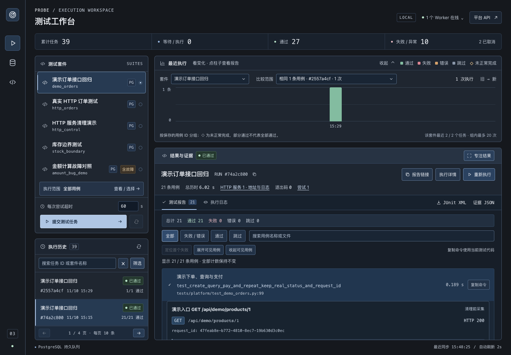
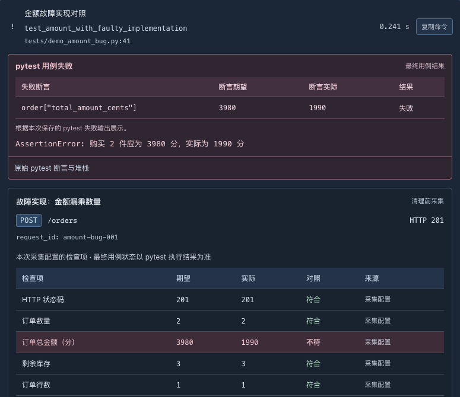
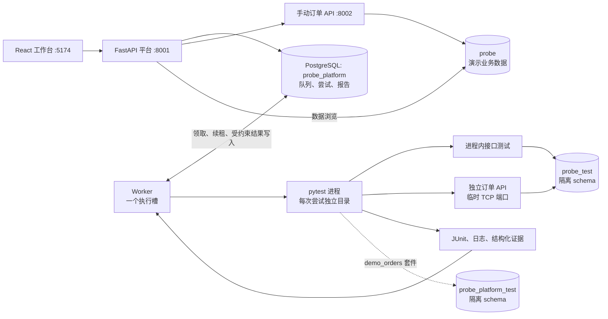

# Probe

[](https://github.com/Tsy-iii/Probe/actions/workflows/ci.yml)

**面向测试开发／SDET 的本地接口测试执行与失败证据工作台。**

从真实 pytest 用例中选择执行范围，在隔离的执行尝试中运行测试，再通过断言输出、HTTP 请求响应、数据库状态和服务日志分析失败。

技术栈：**Python · FastAPI · pytest · httpx · PostgreSQL · SQLAlchemy · React · TypeScript · Vite**。

[English](README.md) · [先看这里](#不启动也能了解项目) · [中文文档导航](docs/README.zh-CN.md) · [架构说明](docs/architecture.md) · [验证记录](docs/verification.md)



*截图来自本地演示。执行历史和统计取自实际本地运行，仅描述这些执行，不作为生产使用量或性能指标。工作台界面与详细操作指南目前以中文为主。*

## 核心能力

- **收集与选择用例**：查看参数化实例和源码位置，运行整个套件或部分用例，保存提交时的选择范围。
- **持久化测试任务**：使用 PostgreSQL 保存队列，通过幂等键协调重复提交，保留任务和每次执行尝试。
- **控制执行过程**：取消排队或运行中的任务，设置每次尝试的超时，并在 Worker lease 过期后进行有次数上限的恢复。
- **验证真实 HTTP**：为测试启动独立订单服务，通过系统分配的 TCP 端口发请求，与手动演示 API 分开。
- **保留失败证据**：在测试数据清理前保存请求响应、选定请求头、检查项、数据库快照、断言输出和日志。
- **查询与复现结果**：搜索和筛选历史，创建关联的新执行，重新打开报告链接，导出 JUnit XML、日志和证据 JSON。
- **体验被测业务**：浏览商品、订单和支付事件，管理演示商品，并从页面调用创建订单、支付和取消接口。

## 不启动也能了解项目

项目内的订单 API 是测试对象。Probe 执行仓库中受信任的 pytest 代码；前端负责选择用例、控制任务和展示已保存的结果，不会根据页面选择自动生成断言。

当前没有托管演示网站。无需安装项目，可以先看上下两张截图，再沿下面三条具体的实现与证据路径阅读：

| 想了解的问题 | 重点看什么 | 入口 |
| --- | --- | --- |
| 下单怎样避免超卖和部分写入？ | 条件扣库存与订单写入共用事务；并发和回滚后的数据库断言 | [订单实现](probe/service.py) · [订单测试](tests/test_orders.py) |
| HTTP 201 为什么仍可能有业务错误？ | 总额预期 3980 分、实际 1990 分，以及保存的 HTTP／数据库观察 | [金额错误复盘](docs/postmortems/incorrect-amount.md) |
| 旧 Worker 为什么不能覆盖恢复后的结果？ | Worker、attempt、状态和 lease 检查，以及旧尝试和清理验证 | [恢复复盘](docs/postmortems/worker-loss.md) · [可靠性测试](tests/platform/test_reliability.py) |

[项目问答](docs/project-faq.zh-CN.md) 解释断言位置、测试隔离、演示编辑与 run／attempt。[验证记录](docs/verification.md) 和 [CI 记录](docs/ci.md) 标明对应的日期、代码版本及验证边界。需要实际执行时，再按[快速开始](#快速开始)准备环境。

## 典型使用流程

完成[快速开始](#快速开始)后：

1. 打开工作台：**http://127.0.0.1:5174**。
2. 选择「真实 HTTP 订单测试」（`http_orders`），打开用例选择窗口。
3. 选择全部或部分用例，提交测试任务。
4. 打开结果报告，查看请求、响应、检查项和数据库前后快照。
5. 运行「金额计算故障对照」（`amount_bug_demo`），观察受控失败。故意错误的实现应该在报告中保持失败。
6. 使用「重新执行」创建关联原任务的新执行；「重放提交」则返回已创建的任务。

项目内的小型订单 API 是测试对象：单商品下单时扣减库存，支付更新状态，取消只恢复一次库存。它为执行平台提供具体的事务、并发和幂等场景。

### 失败证据



*真实本地受控失败的已保存证据：请求返回 HTTP 201，但总金额预期为 3980 分、实际为 1990 分。对应报告的数据库快照还保留了库存从 5 到 3 的变化及错误的订单金额，说明 HTTP 成功响应不能单独证明业务正确。*

## 架构



平台 API 接收和查询任务，独立 Worker 从持久队列读取任务并执行 pytest。测试数据库与演示业务数据、真实平台历史分开。

### 执行与可靠性机制

| 机制 | 实现和范围 |
| --- | --- |
| PostgreSQL 队列 | 使用 `FOR UPDATE SKIP LOCKED`，在同一事务中领取排队任务并创建尝试。项目已依赖 PostgreSQL，因此当前没有 Redis 依赖。 |
| 提交幂等 | 唯一键和规范化请求指纹协调重复提交，冲突内容返回 409。去重范围是任务创建，不涵盖任意外部业务副作用。 |
| Worker lease | 只有原 lease 仍有效时才能续租。默认每 1 秒心跳、lease 为 6 秒。 |
| Attempt fencing | 结果提交检查 Worker、当前 attempt、状态和未过期 lease，旧尝试不能覆盖替代尝试。 |
| 异常恢复 | 替代 Worker 先取得恢复所有权、停止并清理旧尝试，再按规则重新排队。Worker 丢失的恢复有次数上限；断言失败、超时和取消不会被重试成通过。 |
| 执行隔离 | 每次尝试拥有进程／会话、工作目录、pytest 临时目录、产物，并在需要时使用独立 PostgreSQL schema。这是可信测试的隔离，不是安全沙箱。 |
| 证据链 | 用例在断言和 fixture 清理前采集证据；JUnit properties 被解析并保存到 JSONB 报告。TCP 用例额外保留服务地址和服务日志。 |

`cleanup_done` 表示活动测试进程和测试 schema 已清理。日志、报告和工作目录继续保留用于诊断；尚未实现产物自动保留期清理。

详细代码映射和验证入口见[架构与技术取舍](docs/architecture.md)。

## 快速开始

克隆或下载项目后，从仓库根目录运行命令。

### 环境要求

- Python **3.14**：对应当前记录的依赖环境。
- Node.js **22.12+** 或 **20.19+**，以及 npm。
- PostgreSQL **17**：可以使用已有本地实例、Docker Compose，或下方项目内启动工具。
- Worker 进程控制需要 POSIX 环境。已验证 macOS arm64 本地运行及 Ubuntu 24.04 CI；这不代表验证了所有 POSIX 系统。

### 1. 安装依赖并配置环境

```bash
python3 -m venv .venv
.venv/bin/python -m pip install -r requirements.lock.txt

# 保留已有的本地配置。
if [ ! -f .env ]; then cp .env.example .env; fi

cd frontend
npm ci
cd ..
```

`.env.example` 提供开发默认值，不是生产凭据。使用其他 PostgreSQL 实例或端口时，检查四项数据库 URL，并保持数据库用途分离：

| 数据库 | 用途 |
| --- | --- |
| `probe` | 持久保留的手动演示商品、订单和支付事件 |
| `probe_test` | 临时订单测试 schema |
| `probe_platform` | 真实任务历史、尝试和报告 |
| `probe_platform_test` | 临时平台测试 schema，包括 `demo_orders` 套件 |

### 2. 准备 PostgreSQL

**Docker Compose 方式：**

```bash
docker compose up -d postgres
```

初始化脚本在新数据卷中创建额外数据库。已有数据卷保持原样；数据库已存在或初始化不完整时，参考[上手和排查指南](docs/README.zh-CN.md)。Compose 配置已提供，但记录的本地环境尚未验证该启动路径。

**没有 Docker 时，可使用已验证的本地替代方式：**

```bash
.venv/bin/python -m pip install -r requirements-local-db.txt
.venv/bin/python -m probe.local_postgres start
```

它启动真实 PostgreSQL，在缺少数据库时创建四份数据库，并把数据保留在 `.local/postgres/`。该可选路径已在 macOS arm64 验证。

初始化表结构与演示商品：

```bash
.venv/bin/python -m probe.manage init-db
.venv/bin/python -m probe.manage seed
.venv/bin/python -m probe.platform.manage init-db
```

平台表使用 Alembic。订单表采用显式初始化及商品在售状态的 additive SQL 迁移，不属于平台 Alembic 链。seed 不重置已有商品和订单。

### 3. 启动本地工作台

```bash
./scripts/probe start
./scripts/probe status

# 使用完后：
./scripts/probe stop
```

启动器检查已准备好的环境，在后台启动缺少的组件并等待就绪。健康的手动服务会被复用，仍由原终端管理；`stop` 只关闭启动器自己启动的服务。PostgreSQL、已有 `.env` 和演示数据保持原样，依赖安装与迁移仍是显式步骤。

日志追加到 `.local/dev-runtime/`。端口被其他程序占用时，启动器报错并保留该程序。平台／前端端口保持 8001／5174。参见[启动、停止与排查说明](docs/local-runtime.md)，了解归属判断、启动失败回收、Worker 停止和退出码。

<details>
<summary>手动方式：在不同终端启动组件</summary>


**平台 API：**

```bash
.venv/bin/python -m uvicorn probe.platform.main:app --host 127.0.0.1 --port 8001
```

**Worker：**

```bash
.venv/bin/python -m probe.platform.runner
```

**前端：**

```bash
cd frontend
npm run dev
```

**手动订单 API——页面业务操作需要它：**

```bash
.venv/bin/python -m uvicorn probe.main:app --host 127.0.0.1 --port 8002
```

</details>

自动化 TCP 套件会启动自己的隔离服务，无需固定的演示 API。

| 入口 | 默认地址 |
| --- | --- |
| 工作台 | http://127.0.0.1:5174 |
| 数据浏览 | http://127.0.0.1:5174/#data |
| 平台 API 文档 | http://127.0.0.1:8001/docs |
| 订单 API 文档 | http://127.0.0.1:8002/docs |
| PostgreSQL | `127.0.0.1:5433` |

工作台环境面板检查数据库、schema 准备权限、Worker 心跳、产物目录和可选演示 API。Worker 离线时，任务仍可以排队。

## 测试与验证

```bash
# 真实 PostgreSQL 接口与平台检查；缺少数据库时明确失败。
.venv/bin/python -m pytest --require-postgres -q

# 生成本地 JUnit 产物。
.venv/bin/python -m pytest --require-postgres --junitxml=test-results/regression.xml

# 检查平台迁移漂移。
.venv/bin/python -m alembic current
.venv/bin/python -m alembic check

# TypeScript 检查与前端生产构建。
cd frontend
npm run build
```

记录于 **2026-11-11** 的本地回归结果：**209 passed、0 failed、0 skipped**，保留 1 条既有 Starlette TestClient 弃用提示。这是带日期的本地验证，不作为 CI 徽章或性能指标。[验证说明](docs/verification.md) 按记录日期区分检查结果、历史批次和未验证环境。

默认收集包含 HTTP 契约、PostgreSQL 业务、真实 TCP 请求和平台执行／恢复测试。受控失败演示由平台显式选择；外层测试通过可以表示它正确验证了内层任务的失败。

默认回归新增 15 条本地进程管理集成检查，使用真实临时 HTTP 进程、端口和信号验证启动与停止；这些检查不能据此证明 PostgreSQL 事务正确。

单独的 HTTP 契约测试不能证明数据库事务。PostgreSQL 测试检查真实提交结果、竞争、回滚和清理，每条用例通过 fixture 重建数据。本地浏览器验收使用过 Playwright 脚本，但尚无正式提交的 Playwright 套件。[GitHub Actions 配置与分批记录](docs/ci.md) 说明对应提交的 PostgreSQL 回归、前端构建和启动冒烟检查。徽章链接到工作流状态；带日期的本地结果与云端结果属于不同验证批次。

## 已知边界

- 当前面向本地可信测试套件，没有认证、多租户、任意测试上传或安全沙箱。
- 已验证本地多 Worker 行为；生产部署、容量及跨主机分布式故障尚未验证；Linux 验证范围为 Ubuntu 24.04 CI。
- Worker 丢失可能产生新尝试，不宣称测试执行或外部副作用的 exactly-once。
- 创建订单没有幂等键。响应丢失后，应先查询订单状态，再决定是否创建另一笔订单。
- 支付仅为模拟，没有真实扣款、退款、生产用户或外部业务接入。
- 报告与工作目录没有自动保留期清理。结构化证据有限额，并过滤选定请求头和常见敏感 JSON 字段；它不是完整审计链。
- 数据浏览读取有行数上限的快照，搜索和关联筛选只作用于已加载记录。
- 前端开发使用 Vite 的本地 API 代理，没有提供生产静态服务或部署配置。

## 文档导航

| 读者／任务 | 文档 |
| --- | --- |
| 本地启动、状态、停止与服务归属 | [本地运行说明](docs/local-runtime.md) |
| 中文上手与文档导航 | [中文指南](docs/README.zh-CN.md) |
| 不启动也能理解项目与测试边界 | [项目问答](docs/project-faq.zh-CN.md) |
| 队列、lease、fencing、隔离与证据 | [架构说明](docs/architecture.md) |
| 复现检查、理解验证范围 | [验证说明](docs/verification.md) |
| 订单事务与支付幂等 | [订单设计](docs/design.md) |
| 使用用例选择窗口 | [收集与选择](docs/case-selection.md) |
| 真实 TCP 测试与服务清理 | [HTTP 测试](docs/http-testing.md) |
| 历史、关联重跑和报告导出 | [历史与报告](docs/history-and-reports.md) |
| 演示商品与业务接口 | [商品管理](docs/product-management.md) · [订单操作](docs/demo-order-operations.md) |
| 执行演示接口回归 | [演示套件](docs/demo-suite.md) |
| 可复现的受控故障复盘 | [金额、响应丢失与 Worker 恢复](docs/postmortems/README.md) |
| 开发里程碑 | [开发历史](docs/development-history.md) |
| GitHub Actions 检查与产物 | [CI 说明](docs/ci.md) |
| 准备公开发布 | [公开发布检查](docs/public-release.md) |

## Coding Agent 辅助开发

项目使用 Coding Agent 辅助实现、重构、测试初稿、界面迭代和文档整理。源码、断言、设计取舍与实际验证记录均可查阅；维护者负责审阅和验证改动。

Probe 运行时不调用 AI 服务。

## 许可证与仓库信息

MIT License，见 [LICENSE](LICENSE)。

源码：[Tsy-iii/Probe](https://github.com/Tsy-iii/Probe) · [Issues](https://github.com/Tsy-iii/Probe/issues) · [GitHub Actions](https://github.com/Tsy-iii/Probe/actions/workflows/ci.yml)。仓库公开；CI 徽章链接到工作流状态，具体历史执行记录见 CI 说明。
