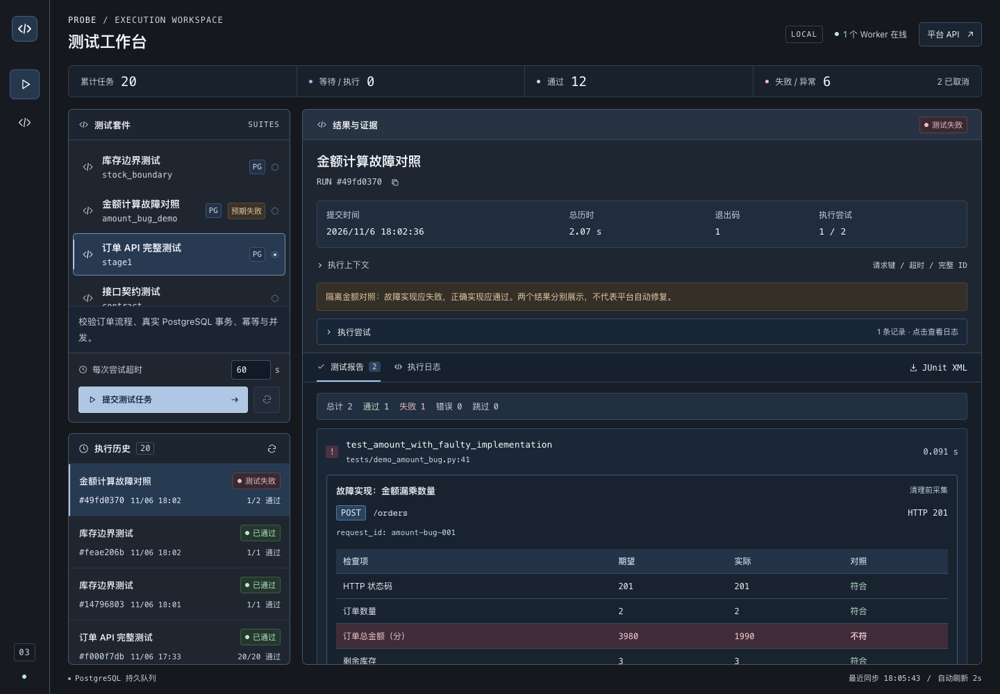

# 亲手用例接入与金额故障对照

> 当前入口见 [主 README](../README.md)；文末旧验收数字和截图为有日期的历史记录，不代表当前服务状态。`.local/` 与 `test-results/` 仅为运行产物位置，历史原始文件不随仓库发布。

本次完成库存边界测试、平台注册、隔离金额错误对照，以及清理前的请求／数据库证据采集。没有推进 GitHub Actions，也没有修改手动订单服务的业务实现。

## 直接从页面体验

打开 http://127.0.0.1:5174，左侧新增两个套件：

1. **库存边界测试**：初始库存 5、单价 1990 分，购买 5 件成功，总额 9950 分，数据库库存为 0、订单数为 1；再买 1 件得到 409，数据库不变。
2. **金额计算故障对照**：同样购买 2 件，分别运行故障和正确实现。故障实现返回 201，但订单金额为 1990 分，违反期望的 3980 分；正确实现验证通过。整组结果应为 1 条失败、1 条通过，任务状态仍是 failed。

选择套件、提交，点击执行历史中的任务，再展开用例。可以看到：

- 用例文件与位置；
- 请求方法、路径、请求 ID、真实状态码；
- 每项检查的期望／实际值；
- 请求和响应 JSON；
- 清理前的商品、订单、计数和时间字段；
- 测试作者提供的定位提示，以及原始 pytest 断言。

单条通过用例默认折叠，点击用例标题展开。两个金额实现分别使用 fixture 重建的数据，不会继承前一条错误订单。

## 故障怎样注入，为什么安全隔离

tests/demo_amount_bug.py 通过 monkeypatch 临时替换测试应用调用的 create_order：仍执行正常库存扣减和订单写入，然后在同一真实 PostgreSQL 事务内将总金额改为单价，模拟漏乘数量。

这个替换只存在于测试进程，测试结束后 pytest 恢复。正确实现用例使用原来的金额公式，验证相同业务契约。它不是平台自动修复，也不是生产服务已经出现的缺陷；提示明确标记为测试作者说明。

演示文件名不匹配 test_*.py，因此默认 pytest 不自动收集这个故意失败的文件。平台注册后可显式运行它。

## 证据怎样留下

probe/test_evidence.py 在断言之前查询真实测试数据库并记录 HTTP 结果，放入 request.node.user_properties。pytest.ini 使用 xunit1，使这些属性写入 JUnit testcase 的 properties；平台 reports.py 解析后放入现有 JSONB report。

因此测试 schema 删除之后，报告中的数据库快照仍能读取。本次不需要数据库结构迁移。

JSON 常见密码／Token 字段会脱敏；认证和 Cookie 请求头不进入结构化证据，URL 的敏感查询值也会隐藏。原始 pytest 输出仍按此前方式保存；使用真实敏感数据时还需要进一步完善日志脱敏。

当前结构化证据覆盖这两个新套件，原有套件仍展示已有断言和日志。还没有自动业务根因判断、源码版本快照和通用录制器。

## 左栏布局修正

执行区与历史区按稳定比例分配高度，历史区最低保留 240px；套件列表、说明、提交提示内部滚动。手机端继续单列显示，历史区独立保留高度。套件增加、长说明与提交提示不会继续压缩历史区。

## 实际验证记录（2026-11-06）

完整默认回归：**44 passed，0 failed，0 skipped，1 warning，45.85s**。原始记录为 test-results/learning-full.junit.xml。新增证据／库存用例及平台注册的针对性检查也通过，最后一次新证据针对性运行为 3 passed。

故意选择金额演示文件的实际结果为 **1 failed、1 passed**；失败的真实断言是 1990 与 3980 不相等。它不会被改成通过。

真实 Chrome 页面验收提交：

| 套件 | 实际任务 ID | 实际结果 |
|---|---|---|
| 库存边界 | <run-id> | passed，1 条用例，2 份请求证据 |
| 金额对照 | <run-id> | failed，总计 2，通过 1，失败 1 |

执行历史高度在提交前、库存执行后、金额执行后均为 **334.65625px**；这是本次 1440px 桌面验收的实际尺寸。四种屏幕宽度 390／768／1024／1440 均没有横向页面溢出，未产生 pageerror。

第一次浏览器验收脚本将用例标题与嵌套的证据折叠标题一起匹配，导致点击定位失败；改为用例的直接子标题后完整验证。这个脚本问题没有计入 pytest 通过数。

本次订单演示库的商品、订单、支付事件与验收前快照逐字段相同；两个测试库中残留测试 schema 均为 0。



[查看库存边界截图](images/learning-stock.png)。图片来自真实执行。

## 可以自己跑的命令

```bash
python -m pytest tests/test_stock_boundary.py --require-postgres -v
```

显式运行故意失败的金额对照：

```bash
python -m pytest tests/demo_amount_bug.py --require-postgres -v
```

第一条应通过；第二条应一失败一通过。默认回归用 `python -m pytest --require-postgres`，不会自动收集金额演示文件。

先读 tests/test_stock_boundary.py 的两个请求，再读 demo_amount_bug.py 的同一金额契约，最后对照报告里的请求与数据库快照。重点解释：HTTP 201 为什么仍可能有业务错误，以及测试清理后为什么还能复盘。
