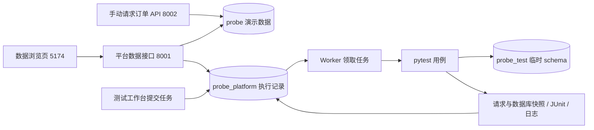

# 数据浏览：把平台和具体业务对应起来

> 当前入口见 [主 README](../README.md)；文末旧验收数字和截图为有日期的历史记录，不代表当前服务状态。`.local/` 与 `test-results/` 仅为运行产物位置，历史原始文件不随仓库发布。

入口：http://127.0.0.1:5174/#data，也可以点击左侧圆柱形「数据」图标。

Probe 运行你在代码里编写的 pytest 用例，并保留结果、日志与请求／数据库证据。小型订单服务是它目前的被测对象；这个页面让第一次使用的人先看懂实际业务和数据，再回到测试工作台理解用例。

## 业务、平台与自动测试数据各自负责什么

| 数据库 | 数据 | 去哪里查看 |
| --- | --- | --- |
| `probe` | 手动请求订单 API 时产生的商品、订单、成功支付事件 | 数据浏览 → 订单演示数据 |
| `probe_platform` | 提交的任务、每次执行尝试、Worker 注册与心跳 | 数据浏览 → 平台执行记录 |
| `probe_test` | 自动测试临时使用的业务数据 | 任务报告中的数据库前后快照；测试结束后清理 |
| `probe_platform_test` | 测试平台自身时的临时任务与 Worker 记录 | pytest 集成测试使用，结束后清理 |

schema 是数据库中的命名空间，相当于同一个数据库内分开的表集合。手动演示和平台任务默认在各自库的 `public`；自动测试用随机 schema 隔离每条用例或每次执行尝试。

提交测试会运行代码中写好的断言。测试里的创建、支付、取消只影响独立测试数据，所以刷新演示订单表时不会出现自动测试订单。历史测试数据通过预先保存的证据观察，不能假装已经清理的表仍然存在。

## 业务表怎么阅读

| 表 | 解决的问题 | 关键关系与字段 |
| --- | --- | --- |
| `products` | 当前卖什么、多少钱、还剩多少 | 商品 ID、名称、整数分单价、库存 |
| `orders` | 谁购买哪个商品、买多少、是否支付 | `product_id` 关联商品；数量、下单时总金额、状态、创建与更新时间 |
| `payment_events` | 成功处理了哪些支付事件，支持重复回调去重 | `event_id` 唯一；`order_id` 关联订单；金额、登记时间 |

页面使用与测试工作台一致的紧凑摘要、表格和侧边抽屉。点击任意记录行只打开详情，不切换表格或添加筛选，关闭后保留搜索、筛选、滚动位置和选中行。只有点击详情中的关联按钮才导航到另一张表并应用明确筛选；直接切换表格标签会清除旧表的关联筛选、搜索和选择。展开「查看完整 JSON 与字段」可查看完整 ID、创建与更新时间；也可以复制完整 ID。金额同时显示元和数据库中的分。

交互参考 [Ant Design 的列表详情抽屉](https://4x-ant-design.antgroup.com/components/drawer/) 与 [NN/g 的表单错误提示指南](https://www.nngroup.com/articles/errors-forms-design-guidelines/)：预览保留原列表上下文，关联导航使用明确入口；未填写的表单首次打开不会报错，字段失焦或提交时才校验。

2026-11-10 本轮验证：前端构建通过；10 组本地 Chrome 交互检查覆盖行预览、关联导航、搜索／状态筛选、表单反馈、草稿关闭、新增后列表、删除恢复、冲突读回、加载上限、桌面与手机宽度。另有 2 项库存窗口检查确认两条完整记录及独立滚动。浏览器写入均使用明确拦截的模拟响应，前后核对真实演示数据和任务记录未变化；本轮 UI 检查不作为新的 PostgreSQL 事务验证。记录见 `.local/browser-check/data-interactions-results.json` 和 `.local/browser-check/inventory-two-rows-results.json`。

顶部展示数据来源切换和真实计数，并提供可折叠的数据概览。右上角「数据说明」展示当前数据库、schema、完整读取时间、订单状态统计，以及业务、平台和测试数据的分工。底部区分显示行数、已加载行数和全表数量。「搜索已加载记录」只过滤当前快照，不查询未加载的历史行。表格独立滚动，小屏幕可以横向滚动查看更多列。

表格中的较长 ID 使用省略形式，悬停可查看完整值；完整字段和 ID 也可以在记录详情中查看与复制。

创建订单时已经扣库存，订单为 `pending`；支付金额匹配后为 `paid`，支付不再次扣库存；取消待支付订单后为 `cancelled`，库存只恢复一次。取消测试任务与取消订单是两个不同操作。

没有支付事件可能只是还没有成功支付。失败、金额冲突或取消后迟到的回调不会写成成功支付事件；该表不是所有回调请求的审计日志。

## 平台表怎么阅读

| 表 | 解决的问题 | 关键关系与字段 |
| --- | --- | --- |
| `test_runs` | 用户提交了一次什么测试、最终结果如何 | 任务 ID、套件、状态、通过计数、尝试次数、超时配置 |
| `run_attempts` | 同一个任务实际被执行过几次、在哪个 Worker 执行 | `run_id` 关联任务；`worker_id`、进程 PID、测试 schema、停止原因、清理状态 |
| `workers` | 哪些 Worker 注册过，近期是否仍有心跳 | Worker ID、PID、最后心跳、最后报告状态、计算后的在线状态 |

点击任务行，在「记录详情」中点击「查看执行尝试 →」筛选关联尝试；点击「打开报告与日志」返回工作台里的该任务。Worker 也是先查看详情，再点击「查看关联尝试 →」筛选；尝试详情可通过「查看所属任务 →」返回对应任务。Worker 恢复可能使一个任务有多次尝试；旧版任务也可能没有尝试记录，不会补造历史。

Worker 历史记录数不等于在线数。一个异常退出的 Worker 最后报告状态可能仍是 `online`，页面会根据最近心跳和租约窗口计算它是否在线。`cleanup_done` 表示活动进程和测试 schema 已清理，报告和日志仍保留。

## 一条可体验的流程

1. 打开数据页，点击商品 1，看当前库存和它关联的订单。
   在商品详情中点击「查看关联订单」回到表格；详情抽屉也可按 Esc 或点击关闭按钮收起。
2. 到 http://127.0.0.1:8002/docs 调用 `POST /orders`，请求体为 `{"product_id":1,"quantity":1}`。记下返回的订单 ID。
3. 回数据页点击「刷新数据」，清除关联筛选并查看订单表：新增一条 `pending` 订单，商品库存减少 1。
4. 在 Swagger 调用 `POST /payments/callback`，传入 `{"event_id":"learn-data-pay-001","order_id":"刚刚返回的订单ID","amount_cents":1990}`。`event_id` 对这次事件保持稳定；下一次独立支付请使用新事件 ID。
5. 刷新并点击刚才的订单：状态为 `paid`，成功支付事件为 1，库存不会再次减少。可用同一请求重复回调，观察事件仍是一条。
6. 到测试工作台运行「库存边界测试」，再到「平台执行记录」刷新：任务与尝试出现新记录。打开报告，观察测试准备的库存 5 与前后快照；演示订单保持不变。

这些手动步骤会产生真实演示订单。商品管理仅在明确操作后写入；页面不自动创建、支付、取消订单或重置数据。服务未启动时，按 [README](../README.md) 启动数据库和订单 API，按 [第三阶段说明](stage3.md) 启动平台 API、Worker 和前端。

## 代码、取舍和验证

`probe/platform/data_views.py` 只查询固定表，通过 SQLAlchemy 建立 PostgreSQL `REPEATABLE READ` 事务，并执行 `SET TRANSACTION READ ONLY`。一组计数和多张表来自一致快照，数据库拒绝该事务中的写操作。只读限制作用于这些查询事务，现有业务连接账号仍服务写入业务。

`probe/platform/main.py` 提供两个入口：`GET /api/data/orders?limit=50` 和 `GET /api/data/platform?limit=50`。参数范围是 1～100，不提供任意 SQL 或库名输入。业务库不可用时返回明确的 503，平台数据仍可单独读取。本次没有修改表结构，无需新增迁移。

`frontend/src/DatabaseView.tsx` 负责数据来源切换、表格、关联筛选、金额展示与报告跳转。金额以分的十进制字符串传输，前端使用 `BigInt` 换算，避免 PostgreSQL bigint 超过 JavaScript 安全整数范围时被舍入。切换数据源时取消旧请求，避免旧响应覆盖当前页面。

顶部统计是完整记录数；每张表默认只加载 50 条，最多 100 条，订单／任务等按最新时间读取。关联筛选仅作用于本次已加载的行，因此不能把“没有加载到”当成“数据库里不存在”。订单的支付事件总数单独计算，不受支付事件表的加载上限影响。当前采用手动刷新，读取时间始终可见；没有历史库存流水时，当前快照也不能还原全部历史操作。

平台列表不读取较大的报告 JSONB；查看证据仍走任务详情。整个页面提供固定表的业务视图，商品管理只提供受控的新增、价格库存编辑、软删除和恢复；没有任意 SQL 编辑器或运行时 AI。

2026-11-09 本机实际验证：

- `python -m pytest tests/platform/test_data_views.py --require-postgres -q`：11 passed。
- `python -m pytest --require-postgres -q`：55 passed，0 failed，0 skipped。1 条 Starlette TestClient 的弃用提示；目前没有为消除提示变更测试依赖。
- 新增接口集成验证涵盖：业务关联与数据不变、金额精度、行上限与全量计数、重复读快照、PostgreSQL 拒绝写入、Worker 心跳过期、参数限制和未初始化业务库的 503。
- `cd frontend && npm run build`：TypeScript 与生产构建通过。
- 本地 Chrome 验证实际页面的计数、商品／订单关系、键盘选择、JSON 展开、任务／尝试关系、报告跳转、直接地址刷新及 1440／900／390 宽度下页面无横向溢出。浏览器中显式拦截响应验证 503 和延迟旧请求的交互，这部分不作为数据库行为证明；浏览器没有提交任务或创建订单。
- 自动测试结束后 `probe_test` 的 `case_` 和 `probe_platform_test` 的 `platform_case_` 临时 schema 均无残留，演示数据与验证前一致。

本地浏览器验收脚本和截图位于 `.local/browser-check/`，它们是本次开发检查材料，尚未接入正式 Playwright CI。

2026-11-09 数据页布局调整验证：在 1440×1000 浏览器窗口中，表格起始位置由约 640px 提前到约 289px，表格区域可见高度约 657px。前端构建通过；验证了商品／订单／事件、任务／尝试／Worker 关联、完整 JSON、键盘选择、搜索和报告跳转，以及桌面、较矮窗口、平板与手机布局。刷新失败时保留的旧快照会明确标注。本次检查只有读取请求，没有创建订单或提交测试任务；这些 UI 结果不作为新的 PostgreSQL 事务验证。

本次读取的演示数据为：商品 2 个；订单 4 个，其中 pending 3、paid 0、cancelled 1；成功支付事件 0。Notebook 库存 7、Pen 库存 3。检查未发现负库存、无效订单值、丢失商品关联、金额／订单状态不一致的支付事件或缺少支付事件的已支付订单。这是本次快照的检查结果，页面以后以实时读取为准。

## 数据概览与图表

「订单演示数据」展示全表订单状态分布与已加载商品的可售库存。点击订单状态，切换到订单表并筛选已加载记录；点击商品库存只打开商品详情，关联订单从详情按钮进入。库存图只是当前快照，展示已加载的在售商品，库存列表独立滚动，不带动左侧订单状态图或补造历史走势。

「平台执行记录」展示已加载任务的状态，以及全表任务／尝试／登记 Worker 数量。点击状态筛选任务，点击关系计数切换对应表。状态分布明确标出「已加载 / 全表」，包含故障演示任务；这些数量不能当作全部用例通过率。Worker 登记记录包含历史进程，当前在线数量依据心跳单独展示。

概览可以收起。桌面默认展开，较矮窗口和窄屏默认折叠；展开后图表区域有高度上限，表格保持独立滚动。只加载部分订单时，全表状态计数仍可能大于当前表格可筛选的数量，空结果会明确说明「已加载记录中没有匹配状态」。

该增量复用现有 PostgreSQL 只读快照接口，没有增加数据库表或修改业务记录。前端构建通过；7 项浏览器检查覆盖真实计数、状态筛选、商品／订单关系、执行关系、窄屏和模拟行数上限。950／768／650 像素高桌面窗口及 390 × 900 手机窗口的表格底部均保持可见。验证数据为 2 个商品、5 个订单、1 条支付事件和 37 个任务，前后核对一致。记录在 `.local/browser-check/data-overview-results.json` 和 `.local/browser-check/data-height-results.json`。

## 从页面编辑数据的边界

查询快照使用只读事务；商品管理操作通过专用写入接口。演示库 `probe` 与自动测试库 `probe_test` 分开，当前自动测试由 fixture 准备自己的单价和库存；修改演示商品不会直接改变这些固定断言的输入。修改测试准备数据，或将来测试共享环境时，才需要重新核对相关预期和数据准备／清理方式。

当前商品管理包含新增、价格与可售库存编辑、软删除和恢复；专用后端接口校验整数分、非负库存和并发变化。已有订单金额保持下单时的值；订单取消和支付继续调用业务接口，任务状态、报告与 Worker 记录由执行流程维护，不能通过表格手改。

完整入口、迁移和接口见 [演示商品管理](product-management.md)。

## 两个小练习

1. 创建一个两件商品的订单，再取消。每一步先预测库存、订单状态和支付事件数量，然后刷新验证。
2. 对比一个 `paid` 业务订单和一个 `passed` 测试任务：分别说明其 ID、所属表、状态变化由谁负责，以及为什么自动测试订单不在演示库中。
