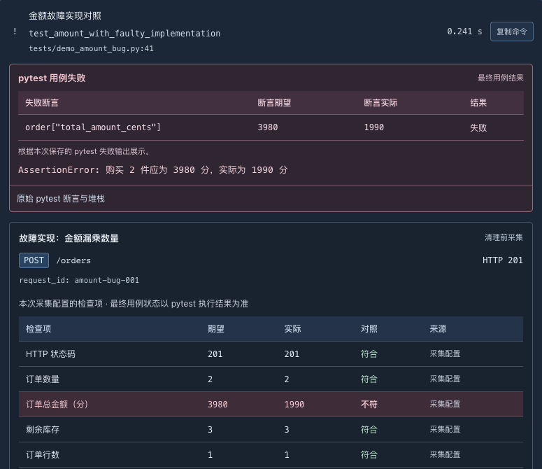

# 金额错误：HTTP 成功，业务断言失败

这是受控测试复盘，展示 Probe 如何保留业务错误证据。它不是线上支付事故；正确业务实现未被改写，故障仅存在于本次测试的替身函数。

## 症状和预期

测试准备商品单价 1990 分、库存 5，购买 2 件。订单应为 3980 分、库存应为 3。

| 观察 | 预期 | 故障实际 |
| --- | --- | --- |
| HTTP 状态 | 201 | 201 |
| 订单数量 | 2 | 2 |
| 总金额（分） | 3980 | 1990 |
| 剩余库存 | 3 | 3 |
| 订单数 | 1 | 1 |

接口成功提交了订单，但金额错误。HTTP 201 只能说明请求按接口路径返回成功，不能替代金额等业务断言。



截图是已有真实本地报告的失败特写；本轮另外用下方命令重新执行并核实结果，没有将截图当作本轮新生成的报告。

## 复现

从仓库根目录、准备好独立 PostgreSQL 测试库后执行：

```bash
.venv/bin/python -m pytest tests/demo_amount_bug.py --require-postgres -v
```

预期 **1 failed、1 passed**，命令退出码 1。该文件不匹配默认测试文件名，只有显式选择才执行。也可以在工作台运行「金额计算故障对照」（`amount_bug_demo`），查看其失败报告。

## 故障注入位置

[对照用例](../../tests/demo_amount_bug.py) 先调用真实的 `create_order` 扣库存、创建订单，再把总金额改成商品单价，模拟漏乘数量。它发生在同一个真实 PostgreSQL 事务中；数量和库存逻辑仍正确。

测试通过 monkeypatch 替换本测试应用的函数。下一条正确实现用例恢复原函数，并重建自己的数据库数据，不继承错误订单。

## 证据与定位过程

1. 请求数量是 2，排除“请求实际上只买一件”。
2. HTTP 201、订单数 1、库存 3，说明请求和写入路径执行完成。
3. 商品单价是 1990 分，返回总额也恰好是 1990 分，把范围缩小到金额公式。
4. 数据库中的订单金额同样是 1990 分，排除仅前端显示或响应转换错误。
5. 对照 [业务函数](../../probe/service.py)，正确公式为 `price_cents * quantity`；本次替身故意改写结果，解释了错误来源。

[证据采集](../../probe/test_evidence.py) 在金额断言执行前保存 HTTP 结果、检查项及数据库前后快照，写入 pytest properties。断言失败后，JUnit 和平台 JSONB 报告仍保留这些数据。

定位提示来自测试作者的明确说明，不是平台自动推断出一个通用根因。

## 正确实现的验证

```bash
.venv/bin/python -m pytest tests/demo_amount_bug.py::test_amount_with_correct_implementation --require-postgres -v
```

本轮该检查通过：金额 3980 分、库存 3、订单 1 条。原始故障用例继续失败，不把预期失败涂成通过；也没有声称平台自动修复实现。

## 边界与面试展开点

- PostgreSQL 事务保证多步修改一起提交或回滚，不保证正数金额就是正确金额。
- HTTP 状态、数据库约束、业务断言是不同层的验证。
- 期望值应来自业务规则和准备的输入，不应照抄实际响应。
- 数据快照是请求前后的观察，不是完整支付账本或历史库存流水。
