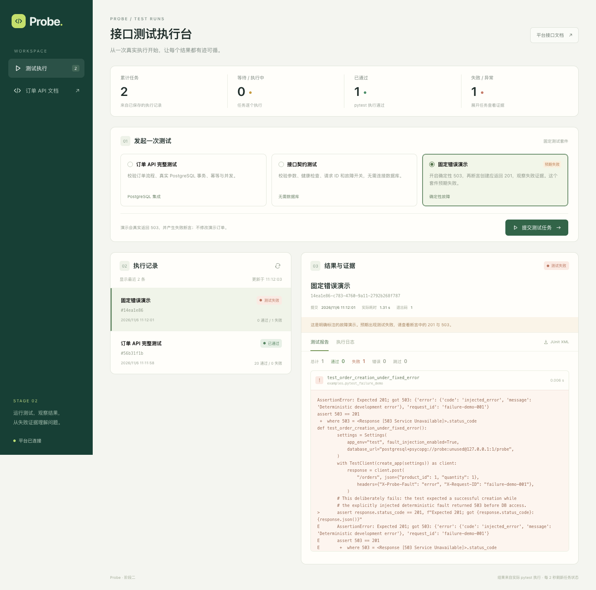

# 第二阶段实际验证记录

> 历史里程碑文档。当前启动以 [主 README](../README.md#quick-start) 和 [中文导航](README.zh-CN.md) 为准；本页的阶段结果只对应当时环境，不是当前运行状态。原始本地产物不随仓库发布。

验证日期：2026-11-06。所有数量、状态和耗时来自本次实际执行；未填入模拟成功率或业务收益。

## 环境与服务

macOS arm64，Python 3.14.4，PostgreSQL 17.9，Node 25.9.0，npm 11.12.1。前端依赖由 frontend/package-lock.json 锁定，Vite 本次实际版本 7.3.7。没有 Docker。

订单 API 8002 和现有 5173 服务保持运行；平台 API 启动在 8001，React 执行台启动在 5174，数据库仍位于 5433。

## 自动化回归

```bash
python -m pytest --require-postgres -v --junitxml=test-results/stage2.junit.xml
```

最终实际结果：**28 passed，0 failed，0 skipped，1 warning，12.82s**。

- 第一阶段 20 条原有测试全部通过。
- 新增 8 条平台接口测试全部通过，使用真实 PostgreSQL probe_platform_test，每例独立 schema。
- 平台测试实际启动 pytest 子进程，读取真实输出与 JUnit，并检查数据库最终记录。

| 平台测试 | 验证结果 |
|---|---|
| 套件与空历史 | 固定套件存在；零任务统计来自数据库 |
| 正常子进程与持久结果 | 202／queued → passed；6 条契约测试通过，退出码 0；报告、日志、下载与 DB 一致 |
| 明确的失败演示 | failed，退出码 1，1 条失败；证据含 Expected 201、503、injected_error 和请求 ID |
| 非法提交 | 非白名单套件与额外 command 字段均 422，任务表没有新增记录 |
| 缺失任务与非法参数 | 404／422，日志和下载也核对任务存在性 |
| FIFO 与独立报告 | 第一项结束时间不晚于下一项开始时间；两份报告互不覆盖 |
| 已完成记录重启读取 | 创建新 app 后读取相同数据库与文件，报告保持一致 |
| 子进程启动错误 | 可控 OSError 记录为 error，计数为 NULL；下一项独立任务仍可运行 |

保留的警告是第一阶段已有的 StarletteDeprecationWarning，提示 httpx TestClient 的弃用方向；未屏蔽。故意失败的 examples/pytest_failure_demo.py 不属于默认 tests/ 收集范围。外层平台测试验证“失败被正确记录”，因此这些外层断言通过。

原始结果：`test-results/stage2.junit.xml`。

## 实际 Chrome 页面验证

使用本机 Chrome 无头模式，从真实 5174 React 页面操作真实 8001 API；临时验收脚本和输出放在 .local/browser-check，不将其提前加入第四阶段的正式 Playwright 测试体系。

实际提交两项任务：

| 任务 | 实际 ID | 观测状态 | 实际结果 |
|---|---|---|---|
| 完整订单套件 | <run-id> | queued → running → passed | 总计 20，通过 20，失败 0，跳过 0，退出码 0 |
| 固定错误演示 | <run-id> | queued → running → failed | 总计 1，通过 0，失败 1，跳过 0，退出码 1 |

完成了页面空状态、套件选择、按钮提交、自动状态更新、逐例报告、失败断言、日志切换、JUnit 下载、刷新后历史记录的检查。下载 XML 中存在真实 failure 元素。浏览器未产生 pageerror。

桌面检查宽度 1440px；手机检查宽度 390px，document.scrollWidth=390、innerWidth=390，没有横向页面溢出。截图来自实际运行页面：



[查看手机截图](images/stage2-mobile.png)。截图中的两个任务为本次实际提交，没有预置演示结果。

浏览器原始观测：`.local/browser-check/results.json`。

## 数据库交叉核对

从真实 probe_platform.test_runs 读取这两项任务：状态、退出码、总数、通过／失败数均与页面和 JUnit 一致；JSONB report.counts 与计数字段一致。原始核对记录：`test-results/stage2-live.json`。

在平台验收之前保存 probe 的 products／orders／payment_events 全量只读快照，执行后再次读取并逐字段比较，**完全一致**。演示库仍有 2 个商品、4 个订单、0 条支付事件；平台测试没有重置或修改手动演示数据。

测试结束后查询两个独立测试库：probe_test 的 case_ schema 残留为 0；probe_platform_test 的 platform_case_ schema 残留为 0。

## 前端构建

实际执行 `npm run build`，TypeScript 检查与 Vite 构建均通过。生成 dist/index.html 和 JS／CSS 文件，没有引入外部字体或 AI 服务依赖。

## 验证边界

当前验证证明单进程、单执行槽、正常本地环境中的任务／报告闭环。未验证强制杀死 Worker 后恢复、挂死用例超时、任务取消、重复提交去重、多 Uvicorn worker、容器资源隔离或远程部署。这些属于下一阶段或后续工作，不能根据本次通过结果推断已经支持。

Docker Compose 仍未实际启动；本次全部数据库验证使用真实本地 PostgreSQL。当前运行页面由 Vite 开发服务器提供；完成了生产构建，但没有部署生产站点。
