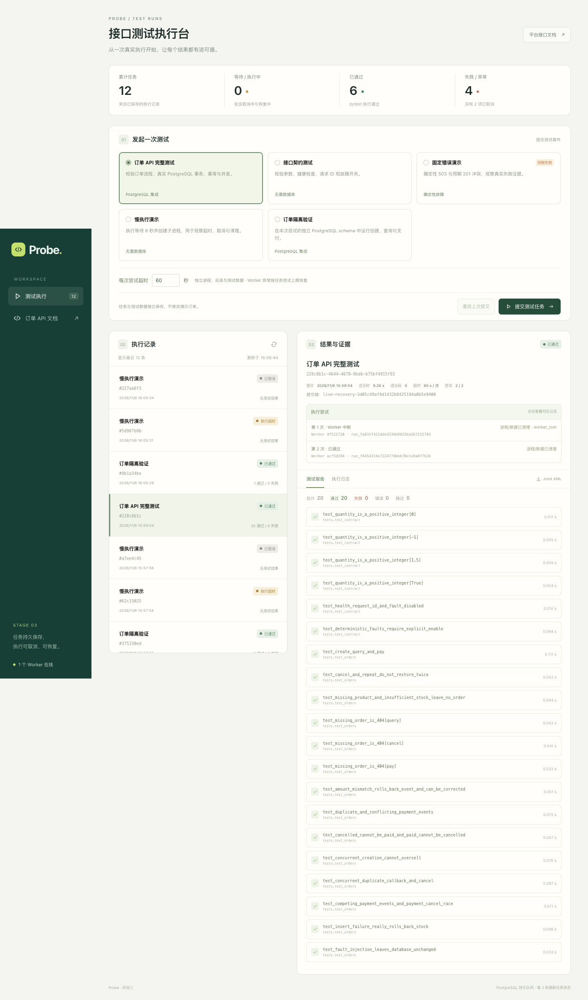

# 第三阶段实际验证记录

> 历史里程碑文档。当前启动以 [主 README](../README.md#quick-start) 和 [中文导航](README.zh-CN.md) 为准；本页的阶段结果只对应当时环境，不是当前运行状态。原始本地产物不随仓库发布。

日期：2026-11-06。环境仍为 macOS arm64、Python 3.14.4、真实 PostgreSQL 17.9、Node 25.9.0。API 8001、Worker 独立进程、Vite 5174 均实际运行。

## 最终回归结果

```bash
python -m pytest --require-postgres -q --junitxml=test-results/stage3.junit.xml
```

**41 passed，0 failed，0 skipped，1 warning，43.06s。** 原始文件为 test-results/stage3.junit.xml。耗时仅表示本次回归，不是平台吞吐量或性能承诺。

包含第一阶段 20 条、第二阶段 8 条，以及第三阶段 13 个执行项。新测试使用独立 probe_platform_test 和 probe_test；需要中断 Worker 时只中断用例自行创建的真实进程。

| 第三阶段执行项 | 实际验证 |
|---|---|
| API 重启后的 queued 任务 | 数据库保留；后来启动 Worker 可执行 |
| 6 个并发同键提交 | 1 个 202、5 个 200，同一任务 ID，数据库只有 1 行；改变套件／超时均 409 |
| queued 取消与重放 | 重复取消不变结束时间，无执行计数；同键重放仍返回原 cancelled 任务 |
| running 取消 | 真实子进程先存在，取消后停止，cleanup_done=true |
| 3 秒超时 | 实际 8 秒等待被终止，子进程停止、没有重试；未完成 XML 被拒绝下载，计数 NULL |
| 非法超时三项 | 0、true、301 分别返回 422 |
| 两个独立 Worker | 同时领取不同任务、使用不同 schema 和工作目录；完成后 schema 均不存在 |
| SIGKILL Worker | 同一任务新尝试恢复通过；旧进程停止，两份 schema 清理；最终报告属于新尝试 |
| 连续两次 Worker 丢失 | 达到 max_attempts=2 后 error，未产生第三次尝试 |
| 旧尝试写回 | 恢复职责转移后、产生新尝试后，旧所有者的完成写入均返回 false |
| 旧结构迁移 | 旧字段与 JSON 报告保留，版本升级到 0002_reliable_runs，重复升级成功 |

唯一警告为原有 StarletteDeprecationWarning，提示 httpx TestClient 的弃用方向；未过滤。

## 真实页面验收

通过本机 Chrome、实际 React 页面和 API 提交任务。最终验收记录：

| 操作 | 实际任务 ID | 结果 |
|---|---|---|
| 正常订单隔离与同键重放 | <run-id> | passed；重放 HTTP 200、ID 不变，累计数不增长 |
| 超时 3 秒 | <run-id> | timed_out、1 次尝试，进程／数据已清理 |
| 执行中取消 | <run-id> | cancelled，本次执行进程 已停止，进程／数据已清理 |

页面还检查了尝试日志选择、取消按钮、状态更新、提交键提示。390px 手机宽度下 document.scrollWidth=390，未产生 pageerror。临时脚本和原始结果存放于 .local/browser-check/stage3-results.json，未提前建设第四阶段的正式 Playwright CI 测试体系。

## 运行中的 Worker 异常恢复

真实平台任务 <run-id> 正在执行时，对负责它的 Worker 发送 SIGKILL。先核验对应进程命令是 probe.platform.runner；API 与前端保持运行，然后启动替代 Worker。

观测到 running（第 1 次）→ recovering → running（第 2 次）→ passed。最终同一个任务 ID，20 条通过；两次尝试分别为 interrupted、passed，旧执行进程已停止，旧／新测试 schema 均不存在，report_attempt_id 指向第二次尝试。

原始证据：test-results/stage3-recovery.json。这属于历史本地验收记录；当前验证请运行对应测试生成自己的记录。



[手机页面截图](images/stage3-mobile.png)。截图统计来自真实记录，其中失败、超时、取消包含主动执行的验收场景。

## 数据与迁移核验

实际已有 5 条第二阶段任务，在升级前保存全量快照；升级后逐字段比较原字段、状态、时间、计数和 JSON 报告，完全一致。旧日志与 JUnit 接口仍可访问。

订单演示库 products／orders／payment_events 在本阶段前后逐字段相同。测试 schema、活动执行进程和尝试清理状态另做核查；结果存放 test-results/stage3-audit.json。

## 构建与验证边界

TypeScript 与 Vite 生产构建通过。当前运行页面仍为本地开发服务器，没有部署生产站点。

`python -m alembic check` 实际返回 No new upgrade operations detected，当前 ORM 与迁移后的数据库结构没有检测到漂移。

验证覆盖本地真实 PostgreSQL、POSIX 进程、多个 Worker、SIGKILL 与不完整报告。Linux／Windows、PostgreSQL 网络分区、容器资源限额、Redis、远程分布式环境和安全沙箱均未实测。当前没有自动删除报告／工作目录的保留期策略；cleanup_done 指活动进程和测试 schema 清理。

不宣称 exactly-once 执行：Worker 丢失可能造成测试重新执行，独立尝试与数据隔离使当前白名单套件可安全验证重试。第四阶段 GitHub Actions、故障复盘与正式 UI 测试仍待推进。
