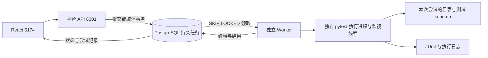

# 第三阶段：可控执行与 Worker 恢复

> 历史里程碑文档。当前启动以 [主 README](../README.md#quick-start) 和 [中文导航](README.zh-CN.md) 为准；本页的阶段结果只对应当时环境，不是当前运行状态。原始本地产物不随仓库发布。

当前支持任务超时、取消、提交键去重、独立尝试与 PostgreSQL schema 隔离，以及 Worker 异常后的有限恢复。API、Worker、前端为独立进程；运行时不接入 AI。

## 三个进程各自负责什么



API 只接收和查询任务。Worker 从数据库领取 queued 行，不依赖 API 进程内存。API 暂时停止时，Worker 可以继续执行；Worker 暂时停止时，API 仍能保存新任务。

当前评估选择 PostgreSQL 持久队列：数据库已有、任务规模小，行锁与任务状态可以在同一事务内处理，无需增加 Redis 服务。Redis／专用消息队列更适合后续吞吐量和调度扩展；这次没有性能数据支撑引入额外基础设施，也没有安装 Redis。

## 启动与迁移

启动完成后访问 http://127.0.0.1:5174。今后重启需要下面三个终端。

终端一：准备数据库、升级平台 schema 并启动 API：

```bash
# Run from the repository root
source .venv/bin/activate
python -m pip install -r requirements.lock.txt
python -m probe.local_postgres start
python -m probe.platform.manage init-db
python -m uvicorn probe.platform.main:app --host 127.0.0.1 --port 8001
```

终端二：启动 Worker，每个 Worker 同时执行一个任务：

```bash
# Run from the repository root
source .venv/bin/activate
python -m probe.platform.runner
```

终端三：启动前端：

```bash
cd frontend
npm ci
npm run dev
```

订单服务 8002 继续按原 README 启动。当前已有订单测试通过 TestClient 调用应用，使用 probe_test，无需网络访问演示服务 8002。

如果要接管本次启动的后台服务，可用 `lsof -nP -iTCP:8001 -iTCP:5174 -sTCP:LISTEN` 确认 Probe API／Vite 进程后停止它们，再在自己的终端启动。Worker 的启动 PID 与 ID 在 `.local/worker.log` 中；确认对应进程后发送 TERM 可正常停止。日志为 `.local/platform.log`、`.local/worker.log`、`.local/frontend.log`。

Alembic 版本：0001_stage2 → 0002_reliable_runs → 0003_case_selection → 0004_rerun_source。第三个迁移为新任务保存用例选择，第四个保存重新执行的来源，旧记录保持空值，详见 [用例目录与选择执行](case-selection.md) 和 [历史与报告](history-and-reports.md)。init-db 会识别旧版无版本表的第二阶段任务库，标记 baseline 后在同一连接事务里升级。旧任务 ID、计数、报告、时间与旧文件目录保留；旧任务补充 legacy-UUID 提交键。重复 init-db 不重置任务。旧 running 且无执行所有者的第二阶段记录会重新进入 queued。

查看当前版本：`python -m alembic current`。检查 ORM 与数据库结构是否漂移：`python -m alembic check`。以后更改已有平台表时，生成并审查新的 Alembic revision，再执行 upgrade；不要通过重复 create_all 升级已有列。

当前对破坏性降级明确拒绝；需要回退时应先审查并恢复备份。订单表没有参与平台迁移。

旧版已完成任务没有新版本的尝试历史，因此 attempt_count 保持 0；报告与执行时间仍保留。不会为旧记录补造 Worker 或尝试数据。

## 可照着做的体验

1. 选择「订单隔离验证」，超时设为 60 秒，提交。通过后查看独立尝试、schema 名、计数和日志。
2. 点击「重放上次提交」。观察返回原任务 ID，累计任务数不增长。该按钮复用上次套件、超时和提交键。
3. 选择「慢执行演示」，超时设为 3 秒。它正常需要等待 8 秒，所以结果应为 timed_out，而不是通过或失败断言。
4. 再提交「慢执行演示」，超时设为 30 秒。等待执行中后点击「取消任务」；观察 cancelling → cancelled 和进程／数据清理状态。
5. 查看验收保留的恢复任务：同一个任务有一次 interrupted 和一次 passed，点击旧尝试查看对应日志。

每次点击「提交测试任务」会产生新的提交键。修改测试代码后要提交新任务；「重放上次提交」用于验证去重，会返回旧任务与旧结果。请求响应不确定时，页面在同一浏览器会话中保留未确认提交键，再提交同样参数会复用它。

## 提交去重：请求键与内容

POST /api/runs 的请求体：

```json
{"suite_id":"contract","timeout_seconds":60}
```

同一逻辑提交使用同一个 Idempotency-Key 请求头：

```bash
curl -i -X POST http://127.0.0.1:8001/api/runs \
  -H 'Content-Type: application/json' -H 'Idempotency-Key: learn-submit-001' \
  -d '{"suite_id":"contract","timeout_seconds":60}'
```

首次返回 202、replayed=false；相同键与内容重放返回 200、replayed=true，任务 ID 一致。相同键改变套件或超时返回 409。缺少请求头时服务生成新键，因此不同无键请求会创建不同任务。

去重由唯一约束和 INSERT ON CONFLICT 实现，指纹为 suite_id 与 timeout_seconds 的规范 JSON 的 SHA-256。它协调并发请求；当前是单用户全局键空间，记录存在期间不自动过期。不会因报告已完成而重新执行，也不保证外部业务副作用的 exactly-once。

## 超时与取消的语义

- timeout_seconds 必须为 1～300 的整数，每次执行尝试独立计时，包括启动阶段。恢复后的新尝试重新计时；任务总历时可能包含租约等待和清理时间。
- 超时停止当前执行进程与同尝试子进程，清理测试 schema，保存 timed_out。超时不自动重试。
- queued 取消在一个事务中变为 cancelled，没有启动时间和测试计数。
- running 取消先持久保存请求并变为 cancelling，执行器停止进程并清理后才变为 cancelled。
- recovering 中取消会保留恢复状态完成清理，最后转为 cancelled，不再重试。
- 重复取消 cancelled 任务不会改变结束时间；其他已终结任务返回 409。
- 取消与终结通过同一任务行锁协调：取消在最终提交前被接受，则取消生效；最终状态已经提交后取消返回冲突。

如果没有完整 JUnit，计数为 NULL，页面明确显示无测试结果。有效的部分报告仍保存实际断言结果，但整体任务状态继续是取消／超时，不能用已通过的部分用例代替完整通过。

慢执行演示还会在执行期间放置一份未完成 XML；正常结束时由 pytest 写成完整报告，中断时则验证它不能被当成可下载报告。取消／超时遇到不完整 XML 会保留原停止原因，下载接口返回 409。

## Worker 领取、租约和过期结果

领取 SQL 使用 SELECT ... FOR UPDATE SKIP LOCKED，按创建时间选择 queued 行。在同一事务内创建 attempt ID、递增次数、保存 worker ID、running 与 lease_until。两个 Worker 竞争时不会领取同一行；每个 Worker 一个执行槽。

默认每 1 秒续租，租约 6 秒。续租必须匹配 worker ID、active_attempt_id、执行状态，并且旧租约仍有效；过期租约不能被原 Worker 复活。界面的 Worker 在线数来自近期心跳，异常退出后可能在租约窗口内短暂显示在线。

租约过期后，新 Worker 先领取恢复职责、改变所有权并进入 recovering，随后停止旧尝试、清理 schema，再决定是否重新排队。完成写入也必须匹配 worker ID、active_attempt_id、有效租约与当前状态；旧进程即使晚回来，也不能覆盖新尝试结果。

当前只对 Worker 丢失恢复，默认最多 2 次尝试（配置上限 3）；每次都保存独立证据。重复丢失达到上限后记录 error。测试断言失败、启动错误、超时、取消都不会被自动重试成通过。

## 执行隔离与清理范围

每次尝试使用独立 Python 进程、工作目录、pytest basetemp、日志／JUnit 路径。需要数据库的套件还使用独立 run_UUID schema；每条用例仍重建商品和表，尝试结束或异常恢复时删除整份 schema。

执行进程有独立监视线程，检查父 Worker、任务所有权、租约、取消与超时。父 Worker 异常退出时，它会尝试停止本次进程组。Worker 和恢复流程也会按环境中不可混淆的 attempt UUID 识别并停止残留进程；不会直接盲杀历史 PID。父 Worker 独立于测试进程计时，能够处理测试线程挂起的情况。

cleanup_done 表示活动执行进程与测试 schema 已清理。日志、报告、stop.json、工作目录与临时文件保留为本次尝试的诊断证据，当前没有自动文件保留期清理。

当前为可信白名单测试的进程／文件／数据隔离，不是安全沙箱或容器资源配额。进程控制已验证 macOS，代码面向 POSIX，Windows 暂不支持；Linux 未在本机实测。恢复依赖 PostgreSQL 可用，不能据此宣称覆盖所有网络分区、内核故障或不可控外部副作用。

文件目录为 `.local/runs/<run_id>/<attempt_id>/`。旧第二阶段文件仍从 `.local/runs/<run_id>/` 读取。GET log／junit 可用 attempt_id 查询参数选择对应尝试，并核验它属于该任务。

## 接口变化与数据表

| 接口 | 新行为 |
|---|---|
| POST /api/runs | timeout_seconds、Idempotency-Key、202 新建／200 重放／409 冲突 |
| POST /api/runs/{id}/cancel | 取消或明确状态冲突 |
| GET /api/runs/{id} | 租约、提交键、超时、尝试数与每次尝试清理结果 |
| GET /api/system | 实际 Worker 在线数、队列类型与租约设置 |
| GET log／junit | 支持按 attempt_id 读取，旧报告仍可访问 |

test_runs 保存逻辑任务与当前所有者；run_attempts 保存每次执行的状态、schema、进程、停止原因、清理与报告；workers 保存心跳与进程标识。Report JSONB 和计数都来自真实 JUnit，未知计数为 NULL。

## 代码阅读与验证

| 模块 | 问题／选择 | 验证证据 |
|---|---|---|
| repository.py | 原子提交去重、SKIP LOCKED 领取、取消、租约与结果写入检查 | 并发提交、两个 Worker、旧尝试拒绝写回 |
| runner.py | 独立 Worker、执行时限、schema 创建／恢复清理、有限重试 | 超时／取消、SIGKILL、重试上限、隔离测试 |
| execution.py / processes.py | 测试进程独立监视与子进程识别 | 真实 slow suite 子进程终止检查 |
| migrations/ / manage.py | 从旧数据结构升级，保留既有结果 | 旧结构迁移测试、实际五条旧记录逐字段核验 |
| frontend | 提交键重放、超时、取消、尝试日志 | 实际 Chrome 操作与手机宽度检查 |

完整回归：

```bash
python -m pytest --require-postgres -v --junitxml=test-results/stage3.junit.xml
```

单独体验 Worker 异常恢复：

```bash
python -m pytest tests/platform/test_reliability.py::test_sigkill_worker_is_recovered_with_new_attempt --require-postgres -v
```

该用例只终止自己创建的测试 Worker，使用 probe_platform_test 和 probe_test，启动替代 Worker 后核对状态、报告和 schema 清理。完整实际结果见 [第三阶段验证记录](stage3-verification.md)。

三个小练习：同键重放后比较任务 ID 与累计数；比较 queued 取消与 running 取消的开始时间／状态；沿着 interrupted → passed 的两次尝试找到不同 Worker、schema 和最终 report_attempt_id。

面试可以展开：为什么持久队列还需要租约和执行 ID？为什么恢复是至少一次执行，并要区分测试失败与 Worker 丢失？用本次记录说明取舍后，再讨论消息队列和容器隔离。
